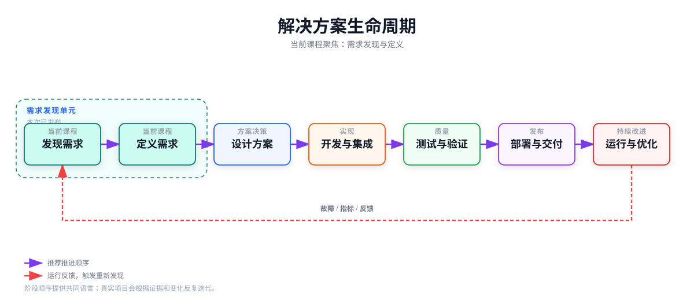

# 解决方案生命周期

## 用一次退款改造串起七个阶段

“晴空商城”的订单、支付、仓库和客服系统彼此独立。客服要手工复制订单号、登录不同后台处理退款，平均需要两天，信息遗漏率约为 8%。管理层希望把处理时间缩短到两小时，并保留人工审核。

面对这个目标，团队不应直接跳到“买哪个工具”。一套方案通常按下面七个阶段推进；每个阶段都在回答一个不同的问题。

1. **发现需求：现在发生了什么，真正要改善什么？**
   团队理解业务目标、参与者、用户任务和当前流程。在示例中，要跟随客服走完一次退款，找出复制、等待和遗漏发生在哪些交接中，并确认“两天”和“8%”的证据，而不是只记录“系统太慢”。

2. **定义需求：这次具体做什么，怎样算完成？**
   团队确认需求、边界、约束、优先级、风险和验收标准。**验收标准**是可观察、可验证的完成条件。示例中需要说清“两小时”从哪个时间点算到哪个时间点、哪些退款必须人工审核、首期不处理哪些情况，以及支付失败时怎样算业务可接受。

3. **设计方案：各部分怎样配合，为什么选择这样做？**
   团队选择架构、接口、数据和安全机制。**接口**是系统之间对请求、响应和失败处理的约定。团队要确定商城、退款服务、支付、仓库和客服各自的边界与数据责任，比较同步等待和异步受理等方案。异步受理是先返回任务编号，再在后台处理，不把整个页面一直卡在等待上。

4. **开发与集成：怎样把设计变成能协同工作的系统？**
   开发人员实现组件并连接外部系统。在示例中，既要有退款服务的内部逻辑，也要处理支付、仓库和客服系统之间的调用、数据字段与失败情况，保证实际行为符合接口约定。

5. **测试与验证：有哪些证据证明方案达到了要求？**
   团队验证功能、质量属性、安全和业务结果。**质量属性**是系统在特定条件下应达到的质量，例如响应速度和可用性。除了正常退款，还要验证支付超时、重复请求、越权访问和人工审核等情况，并检查处理时间与遗漏问题是否达到既定验收标准。

6. **部署与交付：怎样上线，并让使用者接住它？**
   团队完成发布、培训、移交和回滚准备。**回滚**是在变更出现问题时恢复到之前的可用状态。客服需要知道怎样处理待审核任务，运行人员需要取得操作和排障说明，团队也要在发布前准备好恢复办法。

7. **运行与优化：真实使用后，怎样发现问题并继续改进？**
   团队监控、排障、复盘和持续改进。在示例中，要持续观察退款处理时间、失败和遗漏情况，分析人工审核是否积压，再根据真实证据调整流程或系统。

## 阶段不是单向流水线

这七个阶段是推荐的推进顺序，不是只能向前的一次性瀑布流程。运行阶段发现的故障、指标变化或用户反馈，会触发重新发现需求、修订定义或调整设计；测试与验证的结果也可能要求团队返回较早阶段。

例如，如果上线后发现处理时间达标，但某类退款频繁进入人工审核，团队就要先查清原因，再决定是修订需求、调整规则，还是修改接口与流程。每次返回较早阶段，都要重新确认受影响的验收标准和风险，而不是只改局部代码。

## 交付物

**交付物**是某阶段产生并交给他人使用的结果。它们帮助下一位参与者继续工作，而不是用来证明“文档已经写完”。常见交付物与阶段的关系如下：

| 交付物 | 主要用途 | 常见使用阶段 |
| --- | --- | --- |
| 需求清单 | 记录目标、范围、优先级和验收条件 | 定义需求，并在后续阶段核对 |
| 上下文图 | 说明系统与用户、外部系统的边界和关系 | 定义需求、设计方案 |
| 风险登记表 | 跟踪风险、影响、负责人和应对措施 | 定义需求，并随证据持续更新 |
| 接口清单 | 记录调用双方、协议、数据和失败处理 | 设计方案、开发与集成 |
| 数据流 | 说明数据从产生到使用、存储和删除的路径 | 设计方案、测试与验证 |
| 架构决策记录（ADR） | 记录重要决定、备选选项和取舍 | 设计方案，并在决定变化时更新 |
| 测试记录 | 保存验证范围、结果和未解决问题 | 测试与验证 |
| 部署手册 | 指导发布、配置和恢复操作 | 部署与交付 |
| 运行手册（Runbook） | 指导运行、排障、恢复和升级 | 部署与交付、运行与优化 |

## 图示

[打开 PNG 预览](../assets/diagrams/solution-lifecycle.png)。图中高亮的“发现需求”和“定义需求”是需求发现单元的示例路径；传统模块的七个单元和 AI 模块的八个单元现已全部发布。运行与优化的故障、指标和用户反馈会重新进入需求发现，因此阶段关系是可迭代的。

下一步：[知识地图](04-knowledge-map.md)。
