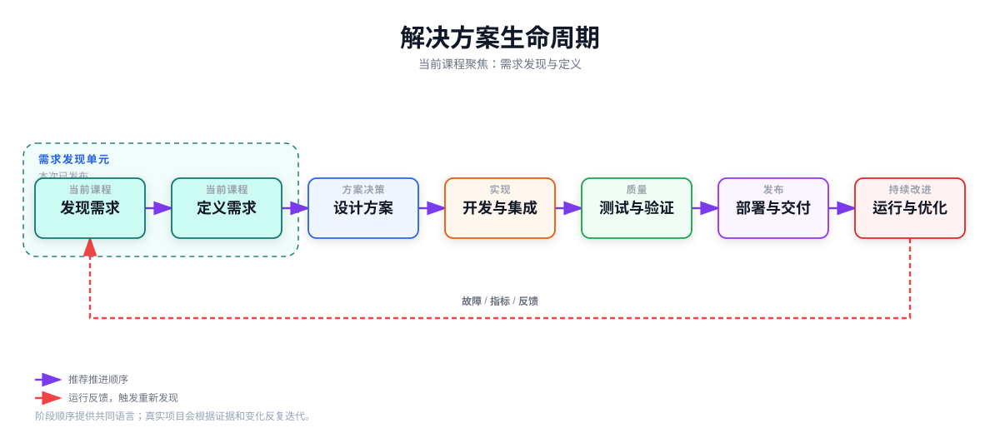

# 解决方案生命周期

## 七个阶段

1. **发现需求**：理解目标、参与者、用户任务和当前流程。
2. **定义需求**：确认需求、边界、约束、优先级、风险和验收标准。
3. **设计方案**：选择架构、接口、数据和安全机制。
4. **开发与集成**：实现组件并连接外部系统。
5. **测试与验证**：验证功能、质量属性、安全和业务结果。
6. **部署与交付**：发布、培训、移交和回滚准备。
7. **运行与优化**：监控、排障、复盘和持续改进。

这七个阶段是推荐的推进顺序，不是一次性瀑布流程。运行阶段发现的故障、指标变化或用户反馈会触发重新发现需求、修订定义或调整设计；验证结果也可能要求团队返回较早阶段。

## 交付物

需求清单、上下文图、接口清单、数据流、风险登记表、ADR、测试记录、部署手册和 Runbook 分别服务于不同阶段。

## 图示

[打开 PNG 预览](../assets/diagrams/solution-lifecycle.png)。图中高亮的“发现需求”和“定义需求”是需求发现单元的示例路径；传统模块的七个单元现已全部发布，AI 模块仍在计划中。运行与优化的故障、指标和用户反馈会重新进入需求发现，因此阶段关系是可迭代的。

下一步：[知识地图](04-knowledge-map.md)。
